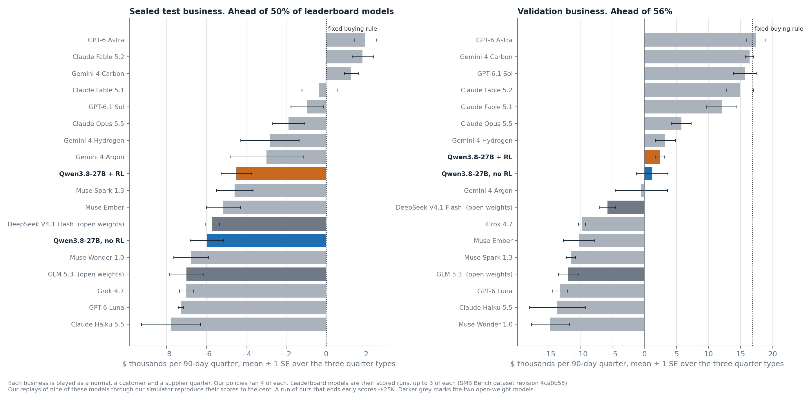

# Teaching an agent to act on delayed consequences

## Contents

1. [TL;DR](#tldr)
2. [Results](#results)
3. [Method](#method)
4. [Findings](#findings)
5. [Next steps, if extended](#next-steps-if-extended)
6. [Limits](#limits)
7. [Code and model](#code-and-model)

## TL;DR

What experience and learning signal make an agent better at noticing, attributing and acting on the delayed consequences of its own decisions, in businesses it has never seen?

- **Written rules transferred to unseen businesses. RL added a smaller, uncertain gain.** Two rules extracted from training records helped the policy protect customers and size purchases. We have not established that the agent can discover those rules unaided.
- **The trained 27B model finishes ahead of 50% of leaderboard models on the sealed business.** Qwen3.8-27B finishes ahead of 56% on validation. Both comparisons include all 16 leaderboard models and place it above both open-weight entries. It still loses $4,500 per quarter on the sealed business, against GPT-6 Astra's $2,000 profit. [Figure 1](#results)
- **A shared starting state gives each training example a meaningful comparison.** Continue an archived frontier quarter from day 60 to 85 and reward the policy only for beating that model's realized profit from the same morning. Four updates of 16 runs cost about $600. [Method](#method)
- **The clearest behavioral success is preventing delayed customer losses.** The final policy protects every account on the first morning in 100% of its validation and test quarters, compared with 10% of replayed frontier test quarters. The protection rule was supplied in the prompt. [Figure 2](#behavior)
- **Most of the gain comes before reinforcement learning.** The $31,400 validation improvement comprises $20,400 from the base model, $7,600 from operating and tool-use instructions, $2,200 from the two rules extracted from training records, and $1,200 from RL. RL adds an estimated $1,500 on the sealed business. [Figure 4](#attribution)
- **Recognizing a cost still does not ensure a useful correction.** The policy buys emergency stock locally on 80% of days and increases its reliance on a deteriorating supplier. It protects customers without yet supplying them efficiently. [Behavior](#behavior)
- **The result is narrower than the ranking alone suggests.** Validation and test contain one business each. Our prompt differs from the leaderboard's, and written instructions account for $9,800 of the validation gain. The additional RL gain remains uncertain. [Limits](#limits)

## Results

*Figure 1. Mean profit per quarter, with one standard error. Each quarter type receives equal weight. Leaderboard rows come from its own scored runs.*

| Policy | Sealed business profit | Leaderboard models below it | Validation profit | Leaderboard models below it |
|---|---|---|---|---|
| Qwen3.8-27B with RL and final instructions | -$4,500 | 50% | $2,400 | 56% |
| Same model and instructions without RL | -$6,000 | 31% | $1,200 | 56% |

These percentages describe the ordering of mean scores against all 16 models. They are not probabilities of winning another run. On the sealed business, the trained policy's leads over Muse Spark, Muse Ember and DeepSeek remain within the uncertainty of the comparison.

The fixed buying rule roughly breaks even on the sealed business and earns $16,900 on validation. The trained policy trails it on both. [Leaderboard snapshot](../data/leaderboard-runs-b5-b6.json) · [Policy results](evidence/tables.md)

## Method

Our hypothesis is that continuing from a shared business state and comparing the eventual outcomes can teach an agent which decisions improve later results, with lessons that remain useful in businesses it has never seen.

The policy runs the whole produce buying desk for a 90-day quarter. Each morning it reads records, chooses products, suppliers and quantities, sets account protection and writes notes for the next morning. Account protection instructs staff to buy missing stock locally to fill a customer's order. The original simulator's grader measures the change in net business value after costs and obligations. Judging the completed quarter lets later purchases, lost customers and spoiled stock determine whether an earlier decision was useful.

### Curriculum

Start states are exact replays of archived frontier quarters on four training businesses, each with three quarter types. We retain an archive only when its transcript is available and its replay has a graded profit. Replaying the preceding actions gives the policy the same inventory, outstanding orders and history the frontier model had that morning.

Each update draws four states from days 60 to 85 and runs the policy four times from each. State selection is deterministic, so the reward comparisons use the same businesses, frontier histories and start days at corresponding updates. Starting late shortens each trial. The curriculum was intended to move earlier, but the reported model received only this late window. [State draws](../scripts/rl.py) · [State bank](../src/smb_buyer/campaign.py)

### Data

Imitating the most profitable frontier transcripts was unreliable in this setup. After supervised fine-tuning, 71% of runs failed through broken tool calls and 0% beat the frontier from the same state. That test used Qwen3.6-35B-A3B, so it does not establish that imitation would fail on the final base model. Continuing from frontier states instead provided a working way to learn from the consequences of new decisions. [Figure 4](#attribution) · [Corpus construction](../scripts/build_sft_corpus.py)

We also read the training businesses' records and wrote two lessons into the prompt. Protect account customers from shortfalls, whose costs include smaller future orders. Buy enough to cover demand and commitments, while limiting each lot to what can sell before markdown. These are the “Protect account customers” and “Buy enough, and only what sells” bullets in the [final prompt](../prompts/buyer_system.txt).

### Learning signal and optimizer

Reward is one bit. The policy receives 1 if its completed quarter earns more than the archived frontier model did from the same morning, and 0 otherwise, including when the policy fails. Both inherit the same history, and the deterministic simulator keeps the world fixed. Each example therefore has its own reference outcome, rather than rewarding a policy simply for starting in a more profitable business.

MaxRL advantages subtract the group's win rate from each reward, then divide by that win rate. A rare win receives more weight. A group in which every run wins or every run loses provides no contrast to learn from. CISPO is the loss used to update the model, limiting the influence of sampled tokens whose probability has grown since sampling. [Implementation](../src/smb_buyer/algorithms.py)

Training uses LoRA rank 32, a small trainable addition to the base model, with a learning rate of 3e-5. The reported checkpoint received four updates of 16 runs, costing about $600. That cost covers this training run. [Experiment accounting](evidence/campaign_scope.md)

### Evaluation

Business 5 is validation and business 6 is the sealed test. Each is played as a normal quarter, a customer quarter in which shorted accounts reduce future orders, and a supplier quarter in which customers react and the cheapest supplier also deteriorates. Our policies run four quarters of each type from the beginning.

The comparison uses the 16 leaderboard models' own scored runs on these same businesses. Replays of nine models supply the detailed behavior comparison and reproduce their scored profits to the cent. The [configuration](story-config.json) identifies the runs behind every figure.

## Findings

### Behavior

*Figure 2. Behavior on the sealed business. Detailed records cover our policies and nine replayed frontier models. The comparison across quarter types includes all 16 leaderboard models.*

#### Account protection

**A supplied rule carries across businesses.** The final policy protects every account from the first morning in 100% of validation and test quarters. On the sealed business, account products remain covered for 99.8% of the quarter on average. GPT-6 Astra protects every account initially in 56% of quarters, and the replayed frontier group does so in 10%. [Coverage records](evidence/report_metrics.json)

> “Keep ON; never toggle (comp + future order shrink + closing reserve >> local premium).”
>
> Final policy, notes in a normal quarter

The [SMB Bench report](//oroagents.com/benchmarks/smb-bench) finding “Learning from a delayed consequence” asks whether a model notices falling account orders, attributes them to its own shortfalls and changes its behavior. Here the policy applies protection before that damage occurs. The records demonstrate transfer of a supplied preventive rule. They do not demonstrate independent discovery of the cause.

#### Demand and action

**The policy acts on shortages, while the underlying interpretation was already present without RL.** It reasons about sales hidden by stockouts on 86% of test mornings, against 85% for the same model and prompt without RL. After a product sells out for at least four hours, its next order is 18% above that product's average, against 11% without RL and 6% for GPT-6 Astra. [Demand and order records](evidence/tables.md)

> “Let me estimate true demand from the sales data (d13, d14, with OOS correction)”
>
> Final policy, day 15 of a customer quarter

This addresses SMB Bench's “They notice, and don't act” finding, but the size of the response depends on the measure. Figure 2 shows 0.23 extra days of stock after a bad stockout week, against 0.18 without RL and 0.22 for Astra. Walk-in demand filled rises from 70% to 74%, still below Astra's 80%. Stronger orders have not fully closed the supply gap. [Behavior measurements](evidence/report_metrics.json) · [Demand filled](evidence/tables.md)

#### Changed conditions

**A small decline under deterioration can coexist with weak operation.** Relative to its normal quarter, the policy loses an average of $1,400 across the customer and supplier quarters, against $4,900 for Astra. This is the smallest decline among the compared policies, but its normal-quarter profit is below every leaderboard model's. It already pays for protection in the normal quarter. The smaller decline cannot by itself establish better adaptation.

#### Remaining gap

**The policy records supply risk without sufficiently changing how it buys.** It holds 0.9 days of stock against a 1.3-day promised delivery time, uses 3.8 suppliers against Astra's 2.9, and relies on local purchases on 80% of days. In the supplier quarter, the cheapest supplier's share of its orders rises from 67% to 75% between the early and later periods. [Purchasing records](evidence/tables.md)

> “Candidate sup_c (d82 arrival, cheap, but 1-day late risk + 15-20% cancellation)”
>
> Final policy, day 81 of a supplier quarter

> “asp 1 is enough; let the cover handle asp line gaps (accept the premium, protect the account).”
>
> Final policy, day 70 of a normal quarter

Its notes identify the cost of local protection, yet local purchases remain routine. Better timing and larger buffers are plausible remedies, but average stock alone does not diagnose the problem. Astra also holds less stock than its promised delivery time and performs better. A replacement buying rule must be tested through its effects on sales, spoilage and account retention.

### Learning signal

*Figure 3. New states are drawn at each update. The two training recipes share starting states through the first four batches. Later dollar-reward batches start earlier in the quarter. The held-out comparisons reuse the same trained checkpoint.*

**The win-or-lose training recipe stayed stable where the dollar-return recipe drifted.** Across the matched late-quarter batches, 94% to 100% of runs using the win-or-lose reward finished, while completion under the dollar reward fell to 69%. It fell further to 50% with earlier starts, and responses grew longer.

The win-or-lose recipe won 38% of its first batch and 50% of its last. Because the states change between batches, that curve does not measure improvement on a fixed set of examples. The comparison also changes how outcomes weight the update, so it supports the combined recipe rather than isolating the effect of the reward alone.

With the final prompt held fixed, RL adds an estimated $1,500 per quarter on the sealed business, with a standard error of $1,100. The validation gain is $1,200 when an early failure by the untrained policy receives the declared loss. Among completed validation quarters, the untrained policy earns more. The evidence supports a possible improvement in reliable execution, with uncertainty still large enough to include no profit gain. [RL comparison](evidence/rl_vs_base.json) · [Validation scoring](evidence/tables.md)

### Attribution

*Figure 4. Successive validation comparisons and an accounting breakdown of the sealed-business gap. The cost differences do not measure recoverable savings.*

**Base-model capability and instructions account for most of the observed gain.**

| Change | Additional validation profit per quarter |
|---|---|
| Qwen3.8-27B in place of Qwen3.6-35B | $20,400 |
| Operating practices and tool-use instructions | $7,600 |
| Two rules extracted from training records | $2,200 |
| Reinforcement learning | $1,200 |
| Total | $31,400 |

Each increment is measured with the preceding changes in place. The amounts describe these combinations and should not be read as independent effects that would add up in any order.

**After RL, costly quarters become less frequent and local spending falls.** Under the same final instructions, local spending falls by $1,600 per quarter on the sealed business. The share of quarters losing more than $10,000 falls from 25% to 8%. Stock levels and supplier use change little. Together with the stronger response to shortages, these observations suggest better execution of an existing buying approach. [Matched policy records](evidence/tables.md)

**Expensive supply accounts for the remaining profit gap.** Against Astra, local purchases cost $7,700 more and dispatch fees cost $1,100 more, partly offset by $2,200 more sales. The net profit gap is $6,500. These are observed accounting differences. Changing purchases could also change revenue, spoilage and customer demand, so the breakdown identifies an experiment to run rather than a saving already established. [Profit components](evidence/tables.md)

## Next steps, if extended

- **Train from earlier decisions.** Start from days 10 to 59, when purchasing patterns and stock levels can affect many later weeks. Test whether judging the completed quarter teaches a more efficient supply plan while preserving customer protection.
- **Make the buffer rule quantitative.** Derive it from training records using demand, delivery reliability, shelf life and outstanding orders. Test whether it reduces local purchases without losing more sales or wasting more stock. The required buffer is an empirical question.
- **Test independent rule discovery.** Give the agent training records without the extracted rules. Require it to identify a delayed effect, connect it to its own earlier decisions, change its purchases and carry the lesson into a new business. This would test the part of the research question that supplied instructions leave open.

## Limits

- Validation and test contain one business each, with four quarters per type. The rankings describe these businesses, and the additional RL effect remains uncertain.
- Leaderboard models use the benchmark's prompt. Our written instructions account for $9,800 of the validation gain, and the frontier models were not tested with them. The reported RL gain also uses an evaluation prompt that differs from the training prompt.
- The predeclared validation selection rule favored the untrained model in a near-tie. Both policies were evaluated on the sealed business as a declared comparison.
- Our model failures receive a $25,000 loss, while the leaderboard excludes failed runs. Evaluation also uses more forgiving tool-call parsing than training and caps reasoning length. The validation RL gain depends on including the untrained policy's early failure.
- Behavior measurements describe what the policies did. They do not isolate which changed action caused the profit gain, or establish that a larger buffer would recover the observed cost difference.

## Code and model

This repository contains the training and evaluation code, final prompt, leaderboard snapshot, figure calculations and supporting evidence. The trained adapter remains in Tinker storage and has not been exported as downloadable weights.

