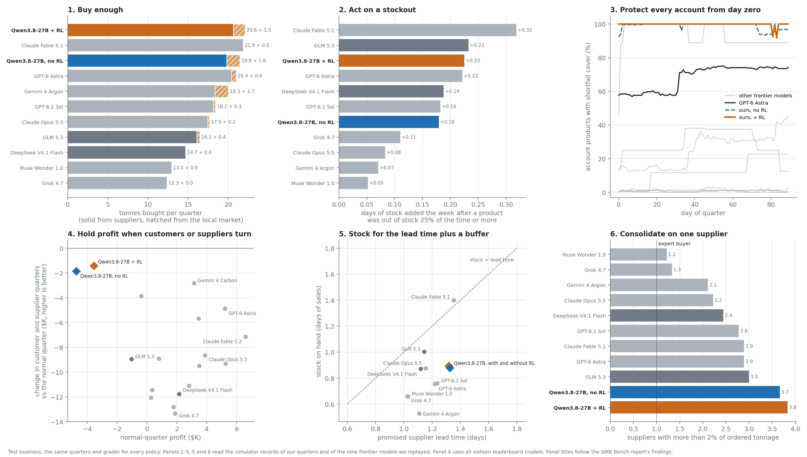
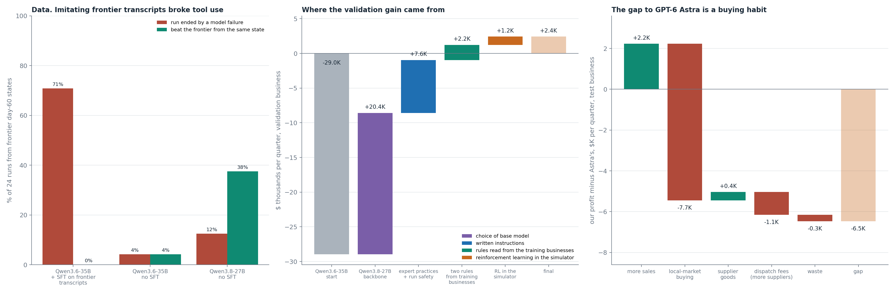

# Teaching an open model to run a business function

Learning from delayed consequences in SMB Bench. Training report, November 2026

## Contents

1. [TL;DR](#tldr)
2. [Results](#results)
3. [Behavior](#behavior)
4. [Learning signal](#learning-signal)
5. [Attribution](#attribution)
6. [Learning process](#learning-process)
7. [Next steps](#next-steps)
8. [Method](#method)
9. [Limits](#limits)
10. [Code and model](#code-and-model)

## TL;DR

**Research question.** What experience and learning signal make an agent better at noticing, attributing and acting on the delayed consequences of its own decisions, in businesses it has never seen?

Acting on a delayed consequence is teachable, but useful learning must extend through the decisions that follow. Rules extracted from training businesses led the final agent to protect every account from the first morning in its validation and test quarters. Training on its own continuations from archived frontier states added a smaller, uncertain gain. The remaining failure was the cost of carrying out that protection. The agent repeatedly relied on emergency supply and continued buying from a deteriorating supplier. These results suggest that transferable experience must teach both which future losses to prevent and how to coordinate present decisions to prevent them economically.

- SMB Bench asks whether an agent can notice a delayed consequence, trace it to its own decision and act before it compounds. Its report found that the strongest buyers, GPT-6 Astra and the scripted expert, win by acting before the consequence arrives, protecting every account from the first morning, and that understanding a problem, changing behavior and improving the business are separate achievements. We treated each as a skill to teach, first in context by evolving the system prompt, then in the weights with reinforcement learning from frontier states. The resulting open 27B policy carries all three to businesses it has never seen.
- Qwen3.8-27B, post-trained in the original SMB Bench simulator, runs a wholesaler's produce buying desk for a 90-day quarter and finishes ahead of 50% of the 16 leaderboard models on a sealed business (56% on validation). That includes both open-weight models, Grok 4.7 and all three Muse models. The six leaders still beat it by more than two standard errors, and GPT-6 Astra leads by $6,500 a quarter.
- The policy continues archived frontier quarters from a morning between day 60 and day 85 and earns reward 1 only if it beats that frontier model's realized profit from the same morning. Four updates (CISPO loss, MaxRL advantages, 16 runs each, about $600 of compute) added $1,500 a quarter on the sealed business and stayed stable where a dollar reward drifted.
- The failures the SMB Bench report names behave like policy failures, not knowledge failures. The policy covers every customer account against shortfall from day zero in 100% of its quarters (frontier 10%), so the delayed loss of a shorted customer never starts. After a stockout it raises its next order 18% above average, against 6% for GPT-6 Astra. It loses less profit than any leaderboard model when customers or suppliers turn.
- Of the $31,400 validation gain, the base model accounts for $20,400, written practice and run-safety rules $7,600, two rules read off the training businesses $2,200, and reinforcement learning $1,200. Reinforcement learning then consolidated those skills in the weights. The policy executed them more consistently, and its sealed-business quarters lost by more than $10,000 fell from 25% to 8%.
- The next skill to teach is supply efficiency. The policy keeps less than one supplier lead time of stock and splits orders over almost four suppliers, so it buys at the local market on 80% of days, and its notes already record the cost. That habit costs more than the whole gap to Astra and is set in the first weeks of a quarter, earlier than our training states.
- Leaderboard models ran the benchmark's own prompt and ours ran a tuned one, worth $9,800 of the validation gain. Validation and test are one business each.

## Results

*Figure 1. Mean profit per quarter with one standard error, each quarter type weighted equally. Leaderboard rows are its own scored runs.*

The sealed business is one of the leaderboard's six, played as a normal quarter, a customer quarter where shorted accounts order less, and a supplier quarter where the cheapest supplier also starts arriving late and short. It is a hard business. The fixed buying rule breaks even and only three leaderboard models make money. The trained policy loses $4,500 a quarter. Its margin over Grok, GLM, GPT-6 Luna, Muse Wonder and Claude Haiku is $2,300 to $3,300 a quarter, about two standard errors or more, and its lead over Muse Spark, Muse Ember and DeepSeek is within noise. Every policy earns less here than on validation (GPT-6 Astra makes $17,300 a quarter on one and $2,000 on the other), and the trained policy sits mid-board on both. The starting model, Qwen3.6-35B, lost $29,000 a quarter on validation.

## Behavior

*Figure 2. Behavior on the sealed business. Records cover our policies and nine replayed frontier models. The changed-quarter panel includes all 16 leaderboard models.*

Measured with one script on the sealed business for the trained policy and the nine frontier models we replayed. Quotes are the policy's own words.

### Account protection

A shorted restaurant or catering account keeps ordering, but less, and the loss arrives weeks later. The SMB Bench report found that only 4% of leaderboard runs where accounts react saw the fall, tied it to their own shortfalls and switched on shortfall cover (a standing instruction to fill any shortfall from the local market) within three days.

The trained policy switched on cover for every account on the first morning in 100% of its 24 validation and test quarters and kept 99.8% of account products covered to the end. GPT-6 Astra did this in 56% of quarters, the frontier as a whole in 10%. Its notes name the delayed costs it insures against.

> **Final policy, notes in a normal quarter**
> "Keep ON; never toggle (comp + future order shrink + closing reserve >> local premium)."

> **Final policy, day 0 of a supplier quarter**
> "Given cover is set for all accounts, even if potatoes fall short, cover would backstop (local potato price 97 vs account 77 → cover loses 20/lb, cheap!)."

The rule came from the training businesses as a written instruction and held on two businesses the policy never saw. In the customer quarter its accounts kept ordering their full 15 tonnes, against 11.6 tonnes for the four strongest replayed frontier models.

### Censored demand

A sold-out shelf records lost sales as nothing. On 86% of test mornings the policy corrects for this before ordering.

> **Final policy, day 15 of a customer quarter**
> "Let me estimate true demand from the sales data (d13, d14, with OOS correction)"

> **Final policy, notes in a supplier quarter**
> "2. New account lines due today/tomorrow -> size gaps vs on-hand + incoming."

After a four-hour stockout its next order is 18% above that product's average, against 6% for GPT-6 Astra. It bought 22.1 tonnes a quarter, the most of the eleven policies we can measure, and covered 89% of true demand, the same as Astra and above the 81% frontier average.

### Changed quarters

Against its own normal quarter, the policy loses $1,400 on average across the customer and supplier quarters, the smallest loss of all 18 policies on the sealed business. GPT-6 Astra loses $4,900. In absolute profit it is ahead of 69% of the leaderboard in the customer quarter and 56% in the supplier quarter. Part of the small loss is a low starting point, because always-on cover buys at the local market even in a calm quarter, and its normal quarter is weaker than any leaderboard model's.

### Remaining gap

The report's expert buyer stocks for the delivery lead time plus a buffer and orders from one supplier. The policy holds 0.9 days of stock against a 1.3-day lead time and splits orders over 3.8 suppliers, against 2.9 for GPT-6 Astra. A late truck, or a day with none due, leaves an account order for cover to fill at the local market at about 2.5 times the cheapest supplier quote. It buys there on 80% of days, knowingly.

> **Final policy, day 70 of a normal quarter**
> "asp 1 is enough; let the cover handle asp line gaps (accept the premium, protect the account)."

In the supplier quarter it records the cheapest supplier's cancellations, then raises that supplier's share of its orders from 67% to 75%, while the four strongest replayed frontier models cut theirs from 83% to 77%.

> **Final policy, notes in a supplier quarter**
> "sup_c d+1 NET21 (15-20% pre-cancel/case), sup_d d+2 NET7 reliable"

> **Final policy, day 81 of the same quarter**
> "Candidate sup_c (d82 arrival, cheap, but 1-day late risk + 15-20% cancellation)"

These two habits cost $7,700 a quarter at the local market and $1,100 in freight against GPT-6 Astra, more than the whole $6,500 gap, which higher sales partly offset. The report's gap between noticing and acting has moved from stockouts to suppliers.

Experience can teach an agent to make a delayed consequence matter in today’s decisions. But acting on that consequence creates further decisions that must work together. The agent can learn to protect something valuable while still failing to organize its behavior around protecting it profitably.

## Learning signal

*Figure 3. Each update draws new states. Both reward designs share starting states for the first four updates, and later dollar-reward updates start earlier in the quarter. The held-out pairs reuse the same trained checkpoint.*

Each training example replays an archived frontier quarter to an exact morning between day 60 and day 85, lets the policy finish the quarter, and compares its profit with what that frontier model earned from the same morning. The engine is deterministic, so every example carries its own fair bar, and the reward is one bit for beating it. On the same states a dollar reward drifted. Responses grew from 3,800 to 7,100 tokens and the share of runs reaching the end of the quarter fell from 100% to 50%. Under the win-or-lose reward, 94 to 100% of runs finished at every update, the share beating the frontier went from 38% to 50%, and the mean margin against the frontier rose from minus $1,100 to even. Each update draws new states, so the training curve is noisy and the held-out pairs carry the evidence. RL raised profit in all four, by $1,000 to $4,400 a quarter, including on the sealed business and under prompts it was not trained with.

## Attribution

*Figure 4. Successive validation comparisons, each measured on top of the one before, and an accounting breakdown of the sealed-business gap to GPT-6 Astra.*

The validation gain of $31,400 a quarter splits by source, each step measured on top of the one before. The move from Qwen3.6-35B to Qwen3.8-27B is worth $20,400, written practice from the SMB Bench report and run-safety rules $7,600, two rules read off the training businesses $2,200, and reinforcement learning $1,200 (and $1,500 on the sealed business).

### Environment

The two rules from the training businesses, cover every account from day zero and size each order to what sells before markdown, produced the account protection and lot sizing frontier models get wrong, on two businesses the policy never saw. We extracted them by reading training records and gave them to the policy as written instructions. The next stage is for the agent to extract such rules from its own experience.

### Weights

Against the same model and prompt without reinforcement learning, on the sealed business, the trained policy bought more from suppliers and $1,600 less at the local market, filled 74% of walk-in demand against 70%, almost never switched cover off, and covered every account on day zero in 100% of quarters against 83%. It reacted harder to stockout weeks on both businesses, and quarters lost by more than $10,000 fell from 25% to 8%. The buffer and the number of suppliers stayed the same. Those habits are set in the first weeks of a quarter, before the day-60 states the updates trained on.

### Data and backbone

Fine-tuning Qwen3.6-35B on the 44 most profitable frontier transcripts ended 71% of its runs on a malformed tool call, and none beat the frontier. From identical frontier states, untrained Qwen3.8-27B earned $1,200 to $2,100 more per run than Qwen3.6-35B. The useful unit of experience was a frontier state to continue from, not a transcript to copy. Experience becomes more useful when it preserves a consequential choice the learner can still make, together with a way to judge the future that choice produces.

## Learning process

We frame the broader learning process around three capabilities.

1. Extract a useful relationship from experience. Determine which earlier decisions explain a later outcome and under what conditions the relationship holds.
2. Make that relationship govern repeated decisions. Carry the lesson into another business and apply it when it matters.
3. Coordinate the resulting behavior. Manage the surrounding choices so that following the lesson improves the complete outcome.

The experiment provides evidence for the second capability with human supplied lessons. It provides a possible additional improvement from training on the agent’s own continuations. Its remaining failures help specify the third capability. Independent extraction remains an open question.

## Next steps

- A numeric buffer rule read off the training businesses, aimed at the local-market buying that makes up most of the gap. Claude Fable 5.1, the only replayed frontier model that stocks above its lead time, buys almost nothing there.
- Reinforcement learning from days 10 to 59, when a quarter's buying pattern and stock levels are set, to test whether the reward alone can teach a delayed-consequence habit.

## Method

Our hypothesis is that agents learn useful long term behavior from experience that connects their choices to later outcomes and gives them practice managing the tradeoffs those outcomes reveal. Progress means extracting lessons that remain useful in new businesses, applying them before avoidable damage occurs, and revising them when conditions change. A first attempt trained one skill, stockout-aware replenishment, as single ordering decisions scored against the benchmark's fixed buying rule. The decision reward kept rising while whole-quarter profit fell, and the gains stayed on the business they were trained on. This work trains the whole desk and grades the whole quarter.

We taught the skills in two stages. First in context, by evolving the system prompt until it carried them, the practices the SMB Bench report credits to its expert buyer, the two rules read off the training businesses, a worked estimate of demand hidden by stockouts, and rules that keep long runs from failing. Then in the weights, with reinforcement learning from frontier states. Fine-tuning on frontier transcripts was tested between the two stages and dropped because it broke tool calls.

The policy is Qwen3.8-27B with a rank-32 LoRA adapter, trained on Tinker, Thinking Machines' hosted training service, in the original SMB Bench simulator and grader with the benchmark's tools, information and limits. Each morning it can query the business's records, read supplier quotes, place orders, set shortfall cover and edit its notes, which are all it carries to the next morning. The grader measures the change in net business value over the completed quarter, so later purchases, lost customers and spoiled stock decide whether an earlier decision was useful.

### Curriculum

Start states are exact replays of archived frontier quarters on four of the leaderboard's six businesses, each played as three quarter types. An archive enters the state bank only when its transcript is available and its replay reproduces a graded profit. Replaying the preceding actions gives the policy the same inventory, outstanding orders and history the frontier model had that morning. Each update draws four states from days 60 to 85 and runs the policy four times from each. The draws are deterministic, so two reward designs see the same businesses, frontier histories and start days at the same update. Starting late keeps each trial short, and the curriculum is built to move earlier. [State draws](../scripts/rl.py) · [State bank](../src/smb_buyer/campaign.py)

### Data

The training data is the policy's own continuations from frontier states, not frontier transcripts, which broke tool calls when imitated (see Data and backbone above). Two rules read off the training businesses' records enter through the prompt, as the "Protect account customers" and "Buy enough, and only what sells" bullets of the [final prompt](../prompts/buyer_system.txt). Protect accounts from shortfalls, whose costs include smaller future orders, and buy enough to cover demand and commitments while limiting each lot to what sells before markdown.

### Learning signal and optimizer

Reward is one bit, 1 when the completed quarter earns more than the archived frontier model did from the same morning and 0 otherwise, including when the policy fails. Both start from the same history in a deterministic simulator, so every example carries its own reference outcome and the reward measures the decisions rather than the luck of the business. MaxRL advantages subtract the group's win rate from each reward and divide by that win rate, so a rare win gets more weight and a group that all wins or all loses gives no update. CISPO is the loss. It caps each token's importance weight, so tokens whose probability rose after sampling cannot dominate the update, while every token still contributes. Training used a learning rate of 3e-5 and four updates of 16 runs, about $600 of compute. The released model came out of 94 experiments, 62 training runs and 32 evaluation experiments. [Implementation](../src/smb_buyer/algorithms.py) · [Experiment accounting](evidence/campaign_scope.md)

### Evaluation

Business 5 is validation and business 6 is the sealed test. Each is played as a normal quarter, a customer quarter in which shorted accounts reduce future orders, and a supplier quarter in which the cheapest supplier also deteriorates. Our policies run four quarters of each type from day 0 with thinking on, temperature 1, top-p 0.95, top-k 20 and a reasoning cap of 57,344 tokens. Frontier rows are the 16 leaderboard models' own scored runs on these businesses, and replays of nine of them, which reproduce their profits to the cent, supply the behavior comparison. The [figure configuration](story-config.json) names the runs behind every figure. The campaign used about $6,500 of compute at list price.

## Limits

- Validation and test are one business each, and 12 test quarters per policy resolve about $2,300 between two policies.
- Leaderboard models ran the benchmark's own prompt. We did not rerun them with ours, so part of the margin is instructions, $9,800 of the validation gain.
- We trained on four of the six leaderboard businesses and report no 18-task average. Frontier numbers are the leaderboard's own scored runs, and our replays of nine of those models reproduce them to the cent.
- Our pre-registered selection rule picked the untrained model on a validation near-tie. Both ran on the sealed business as a declared matched pair, and the untrained one is ahead of 31% of the leaderboard.
- The RL updates ran under an earlier draft of the prompt. Every evaluation uses the final one.
- Qwen's reference parser accepted calls in 25% of test quarters that our stricter training parser would have rejected. A run of ours that ends early scores a $25,000 loss, where the leaderboard drops failed runs. The reasoning cap fired in 8% of test quarters.

## Code and model

This repository holds the harness, training and evaluation code, the final prompt, the leaderboard snapshot, the figure scripts and the transcript evidence. The trained adapter is stored on Tinker, and `scripts/export_model.py` exports it as a PEFT adapter and a merged Hugging Face model once a billing block on our Tinker account lifts.
