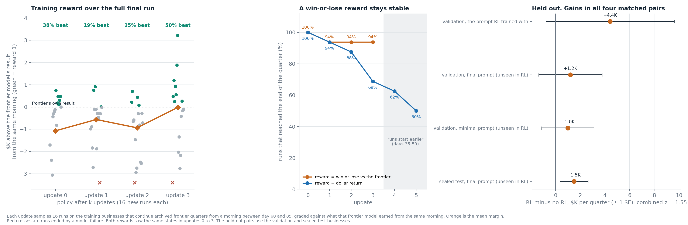

# Teaching an open model to run a business function

Learning from delayed consequences in SMB Bench

Running a business comes down to committing cash before demand is known and finding out weeks later whether the commitment was right. SMB Bench measures this on a wholesaler's produce buying desk run for a 90-day quarter, where sales hide the demand a stockout turned away and a shorted customer quietly orders less weeks later. We post-trained an open 27-billion-parameter model inside the original simulator and tested it on a business it never saw. It now sits in the middle of the frontier, and its transcripts show which parts of the frontier's failures a policy can fix and which still need learning.

Training report, November 2026

## TL;DR

- **An open 27B model can learn a whole business function well enough to sit in the middle of the frontier.** On a sealed business, Qwen3.8-27B with our training finishes ahead of 50% of the 16 models on the current SMB Bench leaderboard, including both open-weight models (DeepSeek V4.1 Flash and GLM 5.3), Grok 4.7, GPT-6 Luna, Claude Haiku 5.5 and all three Muse models. On validation it is ahead of 56%, up from a $29,000 loss per quarter for the model we started from. The policy runs every product, supplier, order size, timing and cover decision for 90 days and carries what it learned to a business it has not seen. The skill is learnable at this scale from simulator experience, written practice and a few reinforcement learning updates.
- **The frontier's named failures behave like policy failures, not knowledge failures.** The SMB Bench report found that frontier models under-buy, notice stockouts without acting, and short their customers. The trained policy buys the most produce of any policy we can measure, raises its next order after a stockout three times as much as GPT-6 Astra, and protects every customer account from the first morning in 100% of its quarters, against 10% of frontier quarters. It handles the delayed consequence by preventing it rather than detecting it, and gives up less profit than any leaderboard model when customers pull back or a supplier fails. A standing policy that is stated, carried and reinforced does what in-context adaptation rarely does.
- **A win-or-lose signal against the frontier's own result is a usable learning signal, and the remaining gap is a timing problem.** Rewarding a run only for beating the frontier model's realized profit from the same morning stayed stable where a dollar reward drifted, and four updates (about $600 of compute) added $1,500 a quarter on the sealed business. What is left is a buffer and supplier habit whose value builds over the whole quarter. The policy describes the risk in its own notes and keeps the habit. We anticipate that reinforcement learning from earlier in the quarter, where those habits are set, should close much of the remaining $6,500 gap to GPT-6 Astra.

## The question

What experience and learning signal make an agent better at noticing, attributing and acting on the delayed consequences of its own decisions, in businesses it has never seen?

Our hypothesis is that agents can learn this from verified experience in a simulator where every consequence is recorded. What should transfer is the relationship between evidence and action, which signal matters, what it implies for the next order, and when a standing commitment is worth its cost. A first attempt trained one skill, stockout-aware replenishment, as single ordering decisions scored against the benchmark's fixed buying rule. The decision reward kept rising while whole-quarter profit fell, and the gains stayed on the business they were trained on. Narrow decisions did not add up to a better buyer, so this work trains the whole desk and grades the whole quarter.

## The trained policy sits in the middle of the frontier on an unseen business

The sealed business is one of the leaderboard's six, played as a normal quarter, a customer quarter where shorted accounts order less, and a supplier quarter where the cheapest supplier also starts arriving late and short. The trained policy loses $4,500 a quarter there, a hard business where the benchmark's fixed buying rule breaks even and only three leaderboard models make money. Its margin over Grok, GLM, GPT-6 Luna, Muse Wonder and Claude Haiku is $2,300 to $3,300 a quarter, about two standard errors or more. Its lead over Muse Spark, Muse Ember and DeepSeek is within noise, and the six models at the top lead it by more than two standard errors. Every policy earns less here than on validation (GPT-6 Astra makes $17,300 a quarter on one and $2,000 on the other), and the trained policy sits in the middle of the board on both.

## It prevents the delayed consequence instead of detecting it

A shorted restaurant or catering account keeps ordering, but less, and the loss shows up weeks later. The SMB Bench report describes learning from this as a three-step chain, seeing the orders fall, tying the fall to your own shortfalls and switching on shortfall cover, a standing instruction to fill any shortfall from the local market. Only 4% of leaderboard runs where accounts react completed that chain within three days.

The trained policy never lets the chain start. In 100% of its 24 validation and test quarters it switched on cover for every account on the first morning and kept 99.8% of account products covered to the end, against 56% of quarters for GPT-6 Astra and 10% for the frontier as a whole. Its notes name the delayed costs it is insuring against.

> **Final policy, notes in a normal quarter**
> "Keep ON; never toggle (comp + future order shrink + closing reserve >> local premium)."

> **Final policy, day 0 of a supplier quarter**
> "Given cover is set for all accounts, even if potatoes fall short, cover would backstop (local potato price 97 vs account 77 → cover loses 20/lb, cheap!)."

The rule came from the training businesses and reached the policy as written instruction, and the policy applied it on two businesses it never saw. In the customer quarter its accounts kept ordering their full 15 tonnes, against 11.6 tonnes for the four strongest frontier models we replayed.

## It reads the demand a stockout hides, and acts on it

A sold-out shelf records lost sales as nothing. On 86% of test mornings the policy corrects for this before it orders, and its notes turn the estimate into a routine.

> **Final policy, day 15 of a customer quarter**
> "Let me estimate true demand from the sales data (d13, d14, with OOS correction)"

> **Final policy, notes in a supplier quarter**
> "2. New account lines due today/tomorrow -> size gaps vs on-hand + incoming."

After a four-hour stockout its next order is 18% above that product's average, against 6% for GPT-6 Astra. It received 22.1 tonnes a quarter, the most of the eleven policies we can measure on the sealed business, and its purchases covered 89% of true demand, the same as Astra and above the 81% frontier average. Where the report found frontier models noticing without acting, the policy acts.

## It holds profit when customers or suppliers turn

Against its own normal quarter, the policy loses $1,400 on average across the customer and supplier quarters, the smallest loss of all 18 policies on the sealed business. GPT-6 Astra loses $4,900. In absolute profit it is ahead of 69% of the leaderboard in the customer quarter and 56% in the supplier quarter. Part of the small loss is a low starting point. Always-on cover buys at the local market even when nothing goes wrong, so its normal quarter is weaker than any leaderboard model's. Insurance that costs money in a calm quarter pays when the world turns.

## Its remaining gap is a habit it can describe but does not change

The report's expert buyer stocks for the delivery lead time plus a buffer and consolidates orders on one supplier. The policy holds 0.9 days of stock against a 1.3-day lead time and splits orders over 3.8 suppliers, against 2.9 for GPT-6 Astra. So a late truck, or a day with none due, leaves an account order for cover to fill at the local market at about 2.5 times the cheapest supplier quote. It buys there on 80% of days and accepts the cost knowingly.

> **Final policy, day 70 of a normal quarter**
> "asp 1 is enough; let the cover handle asp line gaps (accept the premium, protect the account)."

In the supplier quarter it records the cheapest supplier's cancellations, then raises that supplier's share of its orders from 67% to 75% while the four strongest replayed frontier models cut theirs from 83% to 77%.

> **Final policy, notes in a supplier quarter**
> "sup_c d+1 NET21 (15-20% pre-cancel/case), sup_d d+2 NET7 reliable"

> **Final policy, day 81 of the same quarter**
> "Candidate sup_c (d82 arrival, cheap, but 1-day late risk + 15-20% cancellation)"

These two habits cost $7,700 a quarter at the local market and $1,100 in freight against GPT-6 Astra, more than the whole $6,500 gap, which higher sales partly offset. This is the report's gap between noticing and acting, moved from stockouts to suppliers.

## A win-or-lose reward against the frontier is stable and transfers

Each training example replays an archived frontier quarter to an exact morning between day 60 and day 85, lets the policy finish the quarter, and compares its profit with what that frontier model earned from the same morning. The engine is deterministic, so every example carries its own fair bar, and the reward is a single bit for beating it. On the same states, a reward in dollars drifted. Responses grew from 3,800 to 7,100 tokens and the share of runs that reached the end of the quarter fell from 100% to 50%. Under the win-or-lose reward 94 to 100% of runs finished at every update, the share beating the frontier went from 38% to 50%, and the mean margin against the frontier rose from minus $1,100 to even. Each update draws new states, so the training curve is noisy. The held-out comparisons carry the evidence, and RL raised profit in all four of them, by $1,000 to $4,400 a quarter, including on the sealed business and under prompts it was not trained with.

## What came from the base model, the environment and the weights

The validation climb of $31,400 a quarter splits by source. Moving from Qwen3.6-35B to Qwen3.8-27B is worth $20,400. Written practice from the SMB Bench report and run-safety rules add $7,600. Two rules read off the training businesses' records add $2,200. Reinforcement learning in the simulator adds $1,200 on validation and $1,500 on the sealed business. Each step was measured on top of the one before.

**The environment holds rules that transfer.** The two rules we read off the training businesses, cover every account from day zero and size each order to what sells before markdown, produced the account protection and lot sizing that frontier models get wrong, on two businesses the policy never saw. They reached the policy as written instructions. The signal is in the environment, and whether an agent can extract it unaided is the open part of the question.

**The weights learned to commit.** Against the same model and prompt without reinforcement learning, on the sealed business, the trained policy bought more from suppliers and $1,600 less at the local market, filled 74% of walk-in demand against 70%, almost never switched cover off, and covered every account on day zero in 100% of quarters against 83%. It reacted harder to stockout weeks on both businesses, and quarters lost by more than $10,000 fell from 25% to 8%. It did not change the buffer or the number of suppliers. Four late-quarter updates made the policy hold its plan. They did not teach it a habit whose payoff starts in the first weeks.

**Imitation broke the tools, and the backbone mattered most.** Fine-tuning Qwen3.6-35B on the 44 most profitable frontier transcripts ended 71% of its runs on a malformed tool call, and none beat the frontier. From identical frontier states, Qwen3.8-27B earned $1,200 to $2,100 more per run than Qwen3.6-35B without any training. The useful unit of experience was a frontier state to continue from, not a frontier transcript to copy.

## What comes next

The findings point to two experiments. A numeric buffer rule read off the training businesses should cut the local-market buying that makes up most of the gap to GPT-6 Astra, since Claude Fable 5.1, the only replayed frontier model that stocks above its lead time, buys almost nothing there. Reinforcement learning from days 10 to 59, when a quarter's buying pattern and stock levels are set, tests whether the reward alone can teach a delayed-consequence habit. Our broader hypothesis is that these judgments, when to insure, when to buffer, when to leave a supplier, can be learned from experience in one set of businesses and carried to the next.

## Method

The policy is Qwen3.8-27B with a rank-32 LoRA adapter, trained on Tinker, Thinking Machines' hosted training service, in the original SMB Bench simulator and grader with the benchmark's tools, information and limits. Each morning it can query the business's records, read supplier quotes, place orders, set shortfall cover and edit its notes, which are all it carries to the next morning. We trained on four of the leaderboard's six businesses, used business 5 to choose between policies and to spot failures we then checked in the training businesses' records, and kept business 6 sealed until the final evaluation. Each of four updates used four start states with four runs each, a learning rate of 3e-5, the CISPO loss and MaxRL advantages, which divide each group's centered win-or-lose reward by the group's win rate. The final prompt keeps the benchmark's task, tools and scoring and adds the report's expert practices, run-safety rules and the two rules from the training businesses. Evaluation runs four quarters of each type with thinking on, temperature 1, top-p 0.95, top-k 20 and a reasoning cap of 57,344 tokens. The campaign used about $6,500 of compute at list price.

## Limits

Validation and test are one business each, and 12 test quarters per policy resolve about $2,300 between two policies. The leaderboard models ran the benchmark's own prompt, and we did not rerun them with ours, so part of the margin is instructions, $9,800 of the validation climb. We trained on four of the six leaderboard businesses and report no 18-task average. Frontier numbers are the leaderboard's own scored runs, and our replays of nine of those models reproduce them to the cent. Our pre-registered selection rule picked the untrained model on a validation near-tie. Both ran on the sealed business as a declared matched pair, and the untrained one is ahead of 31% of the leaderboard. The RL updates ran under an earlier draft of the prompt, and every evaluation uses the final one. Qwen's reference parser accepted calls in 25% of test quarters that our stricter training parser would have rejected, a run of ours that ends early scores a $25,000 loss where the leaderboard drops failed runs, and the reasoning cap fired in 8% of test quarters.

This repository holds the harness, training and evaluation code, the final prompt, the leaderboard snapshot, the figure scripts and the transcript evidence. The trained adapter is stored on Tinker, and `scripts/export_model.py` exports it as a PEFT adapter and a merged Hugging Face model once a billing block on our Tinker account lifts.
